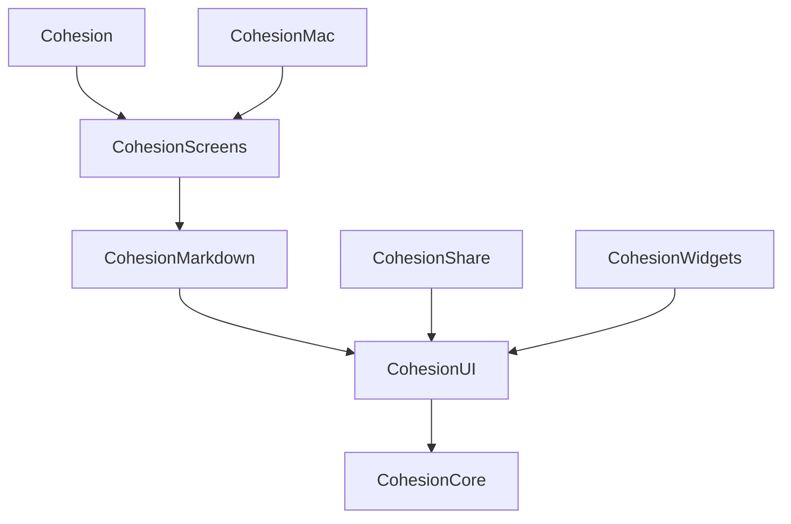

# Architecture

Cohesion's Apple apps are a client of `cohesiond`. The daemon holds every rule and all
the data; the app sends it commands and reloads when it says something
changed. For what a command, an invalidation, an activity or an actor
means, read cohesionhq/cohesion's `docs/architecture.md`
(`../cohesion/docs/architecture.md` in a checkout beside this one). Pushes
and Live Activities come through Cohesion Cloud's iOS Companion.

## Targets

One project, `Cohesion.xcodeproj`. Building the `Cohesion` scheme
builds the four iOS targets, since the app embeds its three extensions; the
`CohesionMac` scheme builds the Mac app.

| Target | Folder | What it is |
| --- | --- | --- |
| `Cohesion` | `Cohesion/` | The app, iPhone and iPad (`com.hellocohesion.app`): its tabs and sidebar, Settings, pushes. |
| `CohesionMac` | `CohesionMac/` | The app on the Mac (`com.hellocohesion.plus.mac`, named Cohesion): its window, Settings window and menu bar. |
| `CohesionShare` | `CohesionShare/` | The share extension: sends a shared URL to an agent's chat. |
| `CohesionWidgets` | `CohesionWidgets/` | The Agents and Tasks widgets, the activities Live Activity and the controls. |
| `CohesionNotificationService` | `CohesionNotificationService/` | Turns an agent push into a communication notification. |

The folders are file-system-synchronized, so a new file joins its folder's
target without editing the project. What the targets share is in the local
packages below; beyond those, the extensions compile `Cohesion/`'s asset
catalog, the Mac app the catalog and the icon, and the widgets the Live
Activity's attributes, listed in `membershipExceptions` in `project.pbxproj`.
The notification service shares nothing. The app, the share extension and the
widgets share one keychain access group, so the extensions read the app's
pairing.

## Packages

Local Swift packages in `Packages/`, built for iOS and macOS as the app
targets are (Swift 5 mode, main actor by default, approachable concurrency).
A declaration another module uses is `public`, with an explicit `public init`
where a struct's memberwise one would do.



| Package › library | Folder under `Packages/` | What it is |
| --- | --- | --- |
| `CohesionCore` | `CohesionCore/Sources/CohesionCore/` | No UI: `Connection/`, `Models/`, `AppLink.swift`, `Intents/` (the App Intents of the controls, Shortcuts and the Tasks widget's rows that open the app, iOS only) and `PlatformImage` (`UIImage` or `NSImage`), which is all it knows of a platform. |
| `CohesionUI` › `CohesionUI` | `CohesionUI/Sources/CohesionUI/` | Views anything can use: `AgentAvatar`, `ServiceIcon` and `SVGIcon`, `SymbolIcon` (a row's gradient and symbol), `Toast`, `errorAlert`, `ProtocolPresentation.swift` (the symbol and color of each value from the daemon) and `Platform.swift`. |
| `CohesionUI` › `CohesionMarkdown` | `CohesionUI/Sources/CohesionMarkdown/` | The Markdown parser, `MarkdownText`, `MarkdownEditor` (`UITextView` or `NSTextView`, one styler) and diagrams in a web view, which is why it's apart: the extensions don't link WebKit. |
| `CohesionUI` › `CohesionScreens` | `CohesionUI/Sources/CohesionScreens/` | `AppModel`, `WindowModel`, every screen, and what a shell builds from: `WindowContent.swift`, `WorkspaceSections.swift`. |

`Platform.swift` is why most of a screen has no `#if`: `Pasteboard` is
`UIPasteboard` or a stand-in by its names, `Image(platformImage:)` draws
either image, and on the Mac iOS's keyboard, title-mode, hover and
full-screen-cover modifiers are stand-ins that do nothing (the cover is a
sheet). `sizedSheet` is every sheet in `CohesionScreens`: on the Mac it gives
the sheet a size, where one would otherwise collapse to its form's fields. Use
`#if os(…)` only for what differs: the sketch and the contact picker are iOS's
alone, and the attach menu's Choose Files… and `photoCropPicker`'s file picker,
cut to its middle square, are the Mac's.

## Connection (`CohesionCore`'s `Connection/`)

- `Pairing.swift`: `SetupCode` (`key|address|fingerprint`, base64) and the
  stored `Pairing`, which holds the client identity in the keychain and the
  pinned SHA-256 of the server's key.
- `CohesionClient.swift`: mutual TLS to `https://host:port`. `register`
  pairs; `call(type, args)` is one `POST /command` with a camelCase
  `type` and snake_case `args` (`nil` values are dropped);
  `webSocket()` opens `wss://…/connect`.
- `Commands.swift`: one method per command, grouped by `// MARK:`. This
  is the only place command names appear.
- `LoadOrigin.swift`: why a screen is loading. `.asked` (opening a screen,
  pull to refresh, Reload) alerts when it fails; `.automatic` (a change, a
  reconnect, a return to the foreground, launching, the reload after an
  action) keeps what's on screen and stays quiet. Either retries after 1, 2
  and 4 seconds while the server can't be reached; a refusal isn't retried.
  `WindowModel`'s lists load automatically, so a launch never alerts. An actor
  session never alerts: with nothing to show, it offers Try Again.
- `KeptReplies.swift`: the last reply to each list a screen opens on
  (workspaces, task folders, tags and saved views, feeds,
  the documents without their contents, contacts with their photos,
  agents, teams, actors, actor sessions, clients, connector accounts, the
  workspace's shown kinds of resource), kept in Caches under `Replies/<server>/` by the app's client
  (`keeping:` on the command in `Commands.swift`) and read back with its
  `kept…()` beside it. `AppModel` starts on the kept workspaces, `RootView`
  and `DocumentListView` show the kept lists on appearing (and on switching
  workspace), then load and watch as before, so a launch shows no empty or
  loading state. Nothing deeper is kept: chats, transcripts, task lists,
  articles, documents and the journal are always fetched. Unpairing (or a
  revoke) forgets every server's. The extensions don't keep replies.
- `Changes.swift`: the socket, one a client however many windows and screens
  listen, open while anyone does: `hello` (updates `vocabulary`), then
  `subscribe`, then `invalidate` with keys decoded as `Invalidation`, or
  `reset`. Views call `for await _ in client.changes(matching:)` to
  reload; a subscribe or reset yields too, as does starting to listen on a
  socket already subscribed. `notices()` yields toasts. The
  socket reconnects with backoff and a ping watchdog, until cohesiond
  revokes the client (an `evicted` frame, or a 403 on connecting): then
  `connection` is `.revoked`, the socket stops, and `AppModel` forgets
  the pairing and shows `RevokedView.swift` until the user pairs
  again.

## Models (`CohesionCore`'s `Models/`)

`Decodable` mirrors of `cohesion-core`'s protocol
(`../cohesion/cohesion-core/src/protocol/`): snake_case fields through
`CodingKeys`, camelCase enum values. `Vocabulary` is the `hello`'s wording
and order for the daemon's kinds; use it rather than hard-coding labels.

## App

Paths from here on are relative to `Cohesion/` for the iOS shell,
`CohesionMac/` for the Mac's, and `CohesionScreens`' folder for the screens.

- `AppModel.swift`: the pairing, the client, workspaces and `pendingLink`,
  shared by every window of the one `WindowGroup`. Told of pairing and
  unpairing through `PairingObserver`, which iOS's `PushRegistration` is;
  the Mac has none. `WindowModel.swift`: what one window has apart from the
  others, its workspace, kept in the window's `@SceneStorage` (a new window
  opens on the workspace last picked in any), the lists its shell shows, kept
  current by `keepsWindowLists`, its notices and errors, and which of the
  sheets `windowSheets` presents are up. `WindowContent.swift` also has
  `WindowContent`, pairing until the app is paired and then the shell (a new
  `WindowModel` on unpairing), and `WorkspacePageView`, a workspace's page in
  any shell. A shell holds where the window is, its selection and stacks, and
  closes what's gone from the lists when `listings` goes up.
- `Cohesion/CohesionApp.swift`: iOS's one `WindowGroup`.
  `Cohesion/Views/WindowTitle.swift` titles a window's scene, which `RootView`
  sets to what's open. The app's commands (Settings…, ⌘,) are in
  `CohesionApp.swift` and act on the focused window through
  `FocusedValues` that `RootView` sets.
- `Cohesion/Views/RootView.swift`: the iPhone's four tabs (Dashboard, where it
  opens, Intelligence, Workspace and Feeds) and the iPad's two columns (the sidebar and what's open). `Cohesion/Views/Sidebar.swift` is the iPad's sidebar around the
  shared `SidebarSections` (`WorkspaceSections.swift`), in the web's order,
  whose workspace part (`WorkspaceSections`) is also the Workspace tab's first
  screen and whose feeds (`FeedSection`) are the Feeds tab's, and
  `Agents/AgentRows.swift` the agents' rows and menus both lists share, with
  `AgentSections`, one section in every shell, whose layout (`AgentSectionLayout`)
  says whether it collapses (only in a sidebar), whether it lists the pinned (a
  tab has `PinnedAgents` above it instead) and which actions it has. Each area's screens live in `<Area>/` (Dashboard, Agents, Actors, Tasks,
  Articles, Documents, Journal, Contacts, Connectors, Extensions, Models
  (Settings → Agents)). `Cohesion/Views/SettingsView.swift` is iOS's Settings,
  a sheet of the server's pages and this device's pushes and Live Activities.
  `ServiceIcon` (`CohesionUI`) draws an extension's or connector's icon (a
  bitmap, or an SVG through `SVGIcon`).
- `CohesionMac/`: the Mac's shell. `CohesionMacApp.swift` has the `WindowGroup`
  and the `Settings` scene. `MacRootView.swift` is one window, a
  `NavigationSplitView` of the shared `SidebarSections` under a workspace
  picker, with the connection and a Settings button at its foot, and the
  selected page beside it. `MacSettingsView.swift` is the Settings window, a
  tab for each of the server's pages and About, which unpairs, over a
  `WindowModel` of its own for the lists its pages ask for.
  `MacCommands.swift` is the menu bar: New Agent…, New Session…, New Team…, New
  Contact… and Add Feed… under File, Dashboard and Reload under View, and a Workspace menu,
  acting on the focused window through `\.windowModel`.
- `AppLink.swift` (`CohesionCore`): `cohesionplus://agent/<id>`, `…/actor-session/<id>`,
  `…/task/<workspaceId>/<id>`, `…/document/<workspaceId>/<id>`, `…/agents`,
  `…/new-task` and `…/new-actor-session`, opened from notifications, controls,
  Live Activities, widgets and URLs; and the same paths
  under `cohesion://`, which agents, tasks and documents write in Markdown.
  `WindowModel.follow`, a shell's `OpenURLAction`, opens an agent or actor session
  in the app and hands any other link to the system; a task or document,
  looked up in the workspace the link names, shows in a sheet over whatever is
  open from `LinkedItemSheet.swift`'s `presentsLinkedItems()`, which every
  sheet with linked text applies so the newest sheet presents it. The older `task/<id>` and `document/<id>`
  still open: the task through `listTasks`' ids across workspaces, the
  document by asking the shown workspace and then each other.
- `Dashboard/`: where a workspace opens (`DashboardView`), to recap and quickly
  dispatch. `DashboardGreeting` is the line for the hour. `DashboardComposer`
  sends a message to the agent its menu picks, with images, and a toast that
  opens the chat (`Toast.link`). `QuickJournalSheet` loads today's entry to see
  what paragraph break it needs, then adds the note with `appendToJournal`.
  `WhatsNewSection` lists the window's `actorSessions` and `agents`, so it follows
  their watches; its rows open through `WorkspacePageView`'s `openAgent` and
  `openActorSession`, which push on the Dashboard tab's stack on iPhone and select
  in a sidebar. Dashboard (⇧⌘D) is a command on iPad and the Mac
  (`\.showDashboard`).
- `Agents/Forwarding.swift`: "Forward" in a task's, document's
  or journal entry's menu, a submenu of the agents (`\.agents`, set by
  `keepsWindowLists`), opens a note composer in a sheet from the view that applies
  `forwardsItems()`; it sends `forward` on `sendAgentMessage`. The chat
  draws a forward as the item's chip, opening as its link does.
- `Agents/Teams.swift`: teams of agents. `WindowModel` loads them
  (`listAgentTeams`, reloaded on `agentTeams`) into `\.agentTeams`, which
  is `nil` from a daemon from before teams and hides them. With a team
  that has unpinned agents, both lists order those by team (`AgentGroup`), then
  those on none; pinned agents stay first whatever their team, as a tab's grid or
  a sidebar's first rows. A row shows its
  team as its subline, and `TeamMenuItems`, in the section's actions in every shell,
  renames or deletes a team. An agent's menu has "Move To" (`MoveToTeamMenu`), its form a team
  picker, and `teamDialogs` names, renames and deletes teams.
  `MemoriesView` sections an agent's memories by scope.
  `MemorySettingsView` is Settings › Memories, as the web's: the global
  memories (`listMemories` with no agent), then each team's and each
  agent's own, read through every agent's `listMemories`; both forget.
- `Agents/AgentInfoView.swift`: the sheet the chat's header opens: Context,
  kept current, then a row for each page it pushes, Identity (`AgentForm`,
  which is also the sheet that creates an agent), Memories (`MemoriesView`),
  Usage and Runs (`AgentRunsView.swift`, both from `listAgentRuns`) and Cues
  (`AgentCuesView.swift`), and Delete Agent. Each page loads its own data and
  reloads on `agent(<id>)`.
- `Agents/AgentChatView.swift`: the chat. A memory line opens
  `MemorySheet`, read-only: the recorded text matched by exact text to
  `listMemories` (the line carries no id), who sees it, and what the agent
  remembers now. A question between agents (`askedAgent`,
  `askedByAgent`) is a quiet line like a script's, opening the question
  and its answer in a sheet; it lays out as the agent's own message, so
  the run that answers it shows no trigger, as the web's feed does. A
  fork's steps (`run_part`) are gathered by run (`CollapsedRuns`, the web's
  `collapseRuns`) into a row that opens `ForkSheet`; `listAgentRuns` says
  which forks are still running while the agent works.
- `Actors/ActorUsageView.swift`: the actors' plan usage, in a sheet
  from Actor Usage in the navigation bar's overflow menu (`ActorUsageMenu`,
  on the Intelligence tab and the iPad's and the Mac's sidebars), as the web's Actors
  page lists it: one section a `listActorUsage` pool (an account several
  actors share, or one actor's own limits): its limits, with where its
  actors work, comma-joined, in the footer. `WindowModel` keeps the usage, reloading on
  `actorUsage`; the menu shows only while a pool with an offered actor
  reports a plan.
- `Actors/ActorSessionView.swift`: an actor session's transcript.
  `listActorSessionMessages` takes no page, so the whole transcript is
  fetched (only on `actorSession(<id>)`, not on every session's change), and the
  view draws the latest 100 messages it shows, with "Load earlier
  messages" for the page before, as the agent chat does. What drawing
  needs (the shown messages, each tool's next message, each question's
  answers) is worked out once a load, not once a redraw. The actor's words
  use `MarkdownText`'s `transcript` style; a tool is a line without an
  icon that opens `ActorToolSheet`, its full summary and timing (the
  protocol carries no tool input or output).
- `Extensions/`: Settings › Extensions. `ExtensionsView`'s add
  menu browses the registries (`BrowseExtensionsView`,
  `searchExtensionRegistries`, leaving out what's installed) or reads a
  script from a file or the clipboard (`previewExtensionScript`). Either
  opens `ReviewExtensionView` in a sheet (`reviewsExtensions`): a
  registry's entry is fetched (`previewExtension`) and marked where it
  differs from the listing, then `registerExtension` sends the script
  shown, replacing the installed one with its identifier. A new install
  pushes its page, since everything starts off; an update is a toast.
- `AttachMenu.swift`: the attach button of the agent chat's and
  actor sessions' composers, a menu: Paste Image, Choose Photos…, and on iPad
  Sketch…, a PencilKit canvas whose drawing is the thread's one sketch.
  The canvas follows the system's light or dark appearance; the PNG is
  always rendered light, dark ink on white.
  It's kept on the device (Application Support `Sketches/<server>/`, one
  file per agent or actor session; a new session's is saved there once it starts) and
  attached as a PNG `AttachmentUpload` carrying the drawing, so editing it
  replaces the attached image. The sheet's Clear empties the canvas to
  start a new sketch; like any edit, it's kept only on Attach. cohesiond
  only sees the image. `attachPresenter` presents the picker and the canvas
  from the composer's body, never the menu: declared in a sheet's toolbar
  item, SwiftUI presents them from the window's root, closing the sheet and
  them with it. While the canvas or a new task's sheet (from a
  control, say) is up the error alerts above it wait
  (`WindowModel.errorHeldForSheets`), since SwiftUI would close them to show
  one. Any new alert that can fire
  on its own above a composer goes through it too.
- `Contacts/`: a workspace's contacts. `WindowModel` loads them
  (`listContacts`, reloaded on `contacts(<workspace>)`) for the Contacts
  page of the Workspace tab and the sidebars, filtered by name as the web filters
  them; `ContactView` shows one from that list, with Message, Call and
  FaceTime (`sms:`, `tel:`, `facetime:`) for its phone numbers and Email
  (`mailto:`) for its addresses, a menu of the numbers when it has
  several. `ContactForm` creates a contact or edits its names and notes;
  methods and the photo change on its page. On iOS, "Add from Contacts…" presents
  the system's `CNContactPickerViewController` (out of process, so no
  contacts permission) and fills a new contact's form from the person
  picked: names, emails, phones and photo (sent at 512 points, as the web
  sends it), not their notes, which need an entitlement. A photo the
  user picks for a contact or their profile comes from `photoCropPicker`
  (`PhotoCropPicker.swift`): the system's `UIImagePickerController`
  with its square crop, since `PhotosPicker` has none.
- `Connectors/`: resources imported through connectors, as the
  web's resource pages. `WindowModel` loads the connector accounts
  (`listConnectorAccounts`, reloaded on `connectorAccounts`) and the
  kinds the workspace shows (`listWorkspaceResourceKinds`, on
  `resourceKinds(<workspace>)`); the shown kinds whose connector has an
  account that can import are the Connectors section of the Workspace
  tab and the sidebars (`WorkspacePage.resources`), reordered by
  dragging, with Edit… opening `ResourceKindsView` to show or hide
  them. `ResourceListView` lists one kind's resources (`listResources`
  with the kind's full name, reloaded on `resources(<workspace>)`),
  filtered by title and account, in an order remembered per kind; it
  refreshes them (`refreshResources`) and pushes `ResourceView`, the
  contents read-only, with Remove…. Import… opens
  `ImportResourcesView`: an account of the kind's connector, a group
  (`listConnectorOrganizationUnits`), and a debounced search
  (`searchConnectorResources`) whose rows import (`importResource`).
  Adding or removing accounts isn't here.
- `Tasks/TaskListMenu.swift`: beside the iPad's sidebar, whose Tasks are one
  row (`TaskSection`, `tasksAreOneRow`), a task list's title menu moving between
  the lists, and the sheet that reorders the saved views.
- `Tasks/Assignee.swift`: a task's assignee, the user, an agent or
  a contact of its workspace (`TaskAssignee`), shown under a row's title
  and set from "Assign To" in a row's menu or the task sheet's Assignee
  picker (`setTaskAssignee`). The user is drawn from their profile
  (`getProfile`, loaded by `WindowModel` into `\.profile` and reloaded on
  `profile`) by photo or initials; an agent or contact missing from the
  lists shows as no one, as on the web.
- `ProfileView.swift`: Settings › Profile, the user's photo (added,
  changed or removed through `photoCropPicker`, sent at 512 points as a
  contact's is, `setProfilePhoto`) and name (saved on Return or losing
  focus, `setProfileName`). It loads its own `getProfile` while shown and
  reloads on `profile`; a daemon from before profiles shows "No Profile".
- `CohesionMarkdown`: the app's own Markdown parser and editor.
  `MarkdownDiagram.swift` draws a ```` ```mermaid ```` block
  (the info string's first word, in any case: `Markdown.opensDiagram`)
  with cohesiond's `renderMermaid`, once it's on screen and connected
  (`\.cohesionClient`, set by `WindowContent`). `MermaidSVG.swift` cleans the
  SVG, and a web view with no script, network or navigation shows it with
  Pele's `--pele-*` variables set from the app's colours, since `SVGIcon`
  draws no text or CSS. `CohesionClient` keeps what was drawn, by source and
  width, for as long as it lasts; the width is taken once, so a resize scales
  what's drawn rather than asking again. Only the agent chat's replies and an
  actor session's transcript (`MarkdownText` with `diagrams`) draw them, as the
  web UI does; a block that's refused, is still streaming in, or hasn't been
  drawn (offscreen, offline, or a daemon without the command) stays as written.
  `Markdown.table` reads a GFM table (a header, a delimiter row, and the
  rows with a `|` after it), which `MarkdownTable.swift`
  draws wherever `MarkdownText` is used.
  Cells don't wrap; a table wider than its space scrolls sideways. Its
  text isn't selectable, since each selectable `Text` costs time on every
  frame of a scroll.

## Pushes and Live Activities

iOS only; the Mac has none of this.

- `Cohesion/Notifications/PushRegistration.swift`: gives the APNs token and
  the Live Activity push-to-start token to cohesiond's iOS Companion
  extension (`callExtension` `registerDevice`), which keeps them and sends
  through the relay; the phone never talks to the relay. Live Activity
  tokens go the same way (`registerLiveActivityToken`, `liveActivityDismissed`),
  and turning off or unpairing calls `unregisterDevice`. The app holds one
  pairing, so one daemon is called; each call goes through `callCompanion(client, ...)`,
  so a phone paired with several would call each, which ignores a code it
  didn't start. A companion before version 9 (its `status` says) is
  refused with a message to update it. It re-registers at every launch and
  return to the foreground.
  `AppDelegate.swift` handles notification taps and replies typed into a
  notification.
- `Cohesion/LiveActivities/CohesionActivitiesAttributes.swift`: the Live
  Activity's attributes and `ContentState`, shared with the widget. They
  must match what the cloud sends.
- `CohesionNotificationService/`: reads the agent from the push payload
  (only its id without the companion's `cohesion:read`) and draws its
  avatar as the `INPerson` image.

## Where to look

| To change… | Look in |
| --- | --- |
| a command or its arguments | `CohesionCore`'s `Connection/Commands.swift` |
| a reply's shape | `CohesionCore`'s `Models/` and `cohesion-core/src/protocol/*_requests.rs` |
| what reloads when | `CohesionCore`'s `Connection/Changes.swift`, `WindowModel` and the view's `changes(matching:)` |
| a screen | `CohesionScreens/<Area>/` |
| what's listed in a window | `CohesionScreens/WindowModel.swift` |
| navigation and the sidebar | `Cohesion/Views/RootView.swift`, `CohesionMac/MacRootView.swift`, `CohesionScreens/WorkspaceSections.swift`, `AppLink.swift` |
| the Mac's menu bar and Settings window | `CohesionMac/` |
| notifications and Live Activities | `Cohesion/Notifications/`, `Cohesion/LiveActivities/`, `CohesionWidgets/`, `CohesionNotificationService/` |
| colors, layout, copy, haptics | `docs/design.md` |
| entitlements, extensions, pushes, links | `docs/platform-integrations.md` |
| a feature's status against the web | `docs/parity-with-web.md` |
| what the product is for | `docs/product-direction.md` |
